<div align="center">


<br>

**Sistema Nacional de Registro y Vigilancia de Biodiversidad.** Un solo lugar para registrar, proteger y divulgar el inventario de flora y fauna de Colombia.

<a href="https://github.com/Chocax/BioHub/actions/workflows/ci.yml"></a>


[Qué es](#1-qué-es-biohub) · [Capturas](#3-capturas) · [Arquitectura](#4-arquitectura) · [Concepto artístico](#5-concepto-artístico) · [Cómo levantarlo](#8-cómo-levantarlo) · [Equipo](#12-equipo-quién-hizo-qué)

</div>

---

## Contenido

1. [Qué es BioHub](#1-qué-es-biohub)
2. [Qué hace](#2-qué-hace)
3. [Capturas](#3-capturas)
4. [Arquitectura](#4-arquitectura)
5. [Concepto artístico](#5-concepto-artístico)
6. [Stack tecnológico](#6-stack-tecnológico)
7. [Estructura del repositorio](#7-estructura-del-repositorio)
8. [Cómo levantarlo](#8-cómo-levantarlo)
9. [Pruebas y CI](#9-pruebas-y-ci)
10. [Despliegue](#10-despliegue)
11. [Ramas y flujo de trabajo](#11-ramas-y-flujo-de-trabajo)
12. [Equipo: quién hizo qué](#12-equipo-quién-hizo-qué)
13. [Solución de problemas](#13-solución-de-problemas)
14. [Documentación](#14-documentación)
15. [Créditos y licencia](#15-créditos-y-licencia)

---

## 1. Qué es BioHub

El Instituto Nacional de Biodiversidad tiene la información de sus expediciones repartida en hojas de cálculo, correos y discos duros. Cuando hay una crisis ecológica, nadie logra reunir los datos a tiempo. BioHub centraliza ese inventario, lo protege y lo publica.

El enunciado plantea seis desafíos. Así responde cada uno la solución:

| Desafío del enunciado | Qué pide | Cómo lo resuelve BioHub |
|---|---|---|
| **El regreso del investigador** | Fichas taxonómicas flexibles, evidencias (audio, foto) y control de los equipos de campo | Plantillas de atributos por especie y versionadas; los hallazgos guardan atributos en JSON validados contra su plantilla. Las evidencias se reconocen por su contenido y se les quita la ubicación GPS antes de guardarlas (JPEG, WAV, MP3, FLAC y OGG). Los equipos tienen custodio obligatorio e historial de custodia |
| **La consulta viral** | Tráfico ×60 sobre una ficha, sin afectar la carga científica | `servicio-consulta-publica` lee de **su propia base**, alimentada por eventos, con caché Redis. Un pico público nunca toca la base del registro científico (ASR1, ASR4) |
| **La ciencia se corrige** | Reconstruir la historia completa de un hallazgo | Cada reclasificación crea una versión nueva. El historial es *append-only* también en la base: el usuario de la aplicación no tiene permiso de `UPDATE` ni `DELETE` sobre él (D60) |
| **El corredor biológico** | Coordenadas exactas solo para personal de alto rango, con validación infalible y centralizada | Todas las coordenadas se cifran con AES-256-GCM y llaves versionadas fuera de la base. Un único componente decide quién las ve (`cientifico_alto_rango`), y ArchUnit impide saltárselo. El público solo ve departamento y región (ASR6) |
| **Plataforma abierta** | Punto de entrada controlado con límite por consumidor y URLs estables | API Gateway propio con API Keys (guardadas como SHA-256), límite por minuto en Redis y la ruta estable `/api/v1/externa/fichas/**` (ASR8, ASR9) |
| **Los reportes que ahogan al sistema** | Analítica pesada sin frenar el registro diario | `servicio-reportes` calcula en segundo plano sobre **su propia base analítica**, alimentada por eventos, y entrega PDF y CSV (HU-09) |

## 2. Qué hace

### Dos webs y una API

| Superficie | Para quién | Qué ofrece |
|---|---|---|
| **Web interna** (`web-interna`, puerto 5173) | Personal del Instituto, con inicio de sesión | Registrar y reclasificar hallazgos, subir evidencias, ver el historial, plantillas de fichas, búsqueda y mapa de hallazgos, equipos de campo, reportes de presión, usuarios y API Keys |
| **Portal público** (`web-publica`, puerto 5174) | Cualquier persona, sin cuenta | Catálogo por especie con fotos, búsqueda por nombre, familia y departamento, y ficha pública sin coordenadas. No guarda nada en el navegador: ni cookies ni almacenamiento local (WP-08) |
| **API para externos** (`/api/v1/externa/fichas/**`) | Universidades y ONG | Fichas públicas con API Key y límite de peticiones por consumidor |

### Qué puede hacer cada rol

| Rol | Puede |
|---|---|
| `investigador_campo` | Registrar hallazgos, reclasificarlos, subir evidencias, editar plantillas y buscar |
| `auditor_cientifico` | Consultar hallazgos y su historial completo de versiones |
| `cientifico_alto_rango` | Todo lo del investigador, más el **mapa con coordenadas exactas** |
| `analista_ambiental` | Pedir y descargar los reportes de presión sobre los ecosistemas |
| `administrador` | Equipos de campo, reportes, usuarios y API Keys. No ve coordenadas exactas |

La matriz completa está en [11-seguridad-y-acceso.md](docs/equipo/11-seguridad-y-acceso.md). La web solo decide qué mostrar: quien autoriza de verdad es el backend (el gateway y cada servicio).

## 3. Capturas

> El portal y el inicio de sesión muestran datos reales del entorno local con datos de ejemplo. Las capturas de la web interna usan datos de ejemplo.

<table>
  <tr>
    <td width="50%">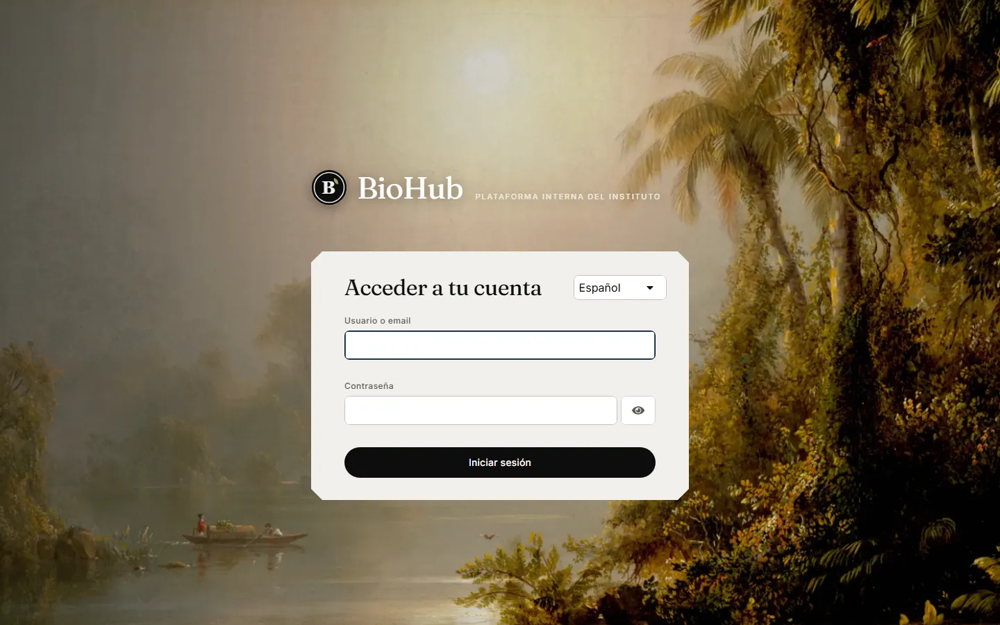<br><sub><b>Inicio de sesión</b> · tema propio de Keycloak, con una obra distinta en cada visita</sub></td>
    <td width="50%">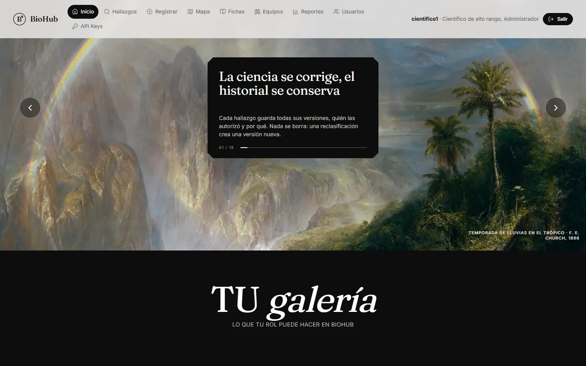<br><sub><b>Web interna · inicio</b> · carrusel de 20 obras con los mensajes del sistema</sub></td>
  </tr>
  <tr>
    <td>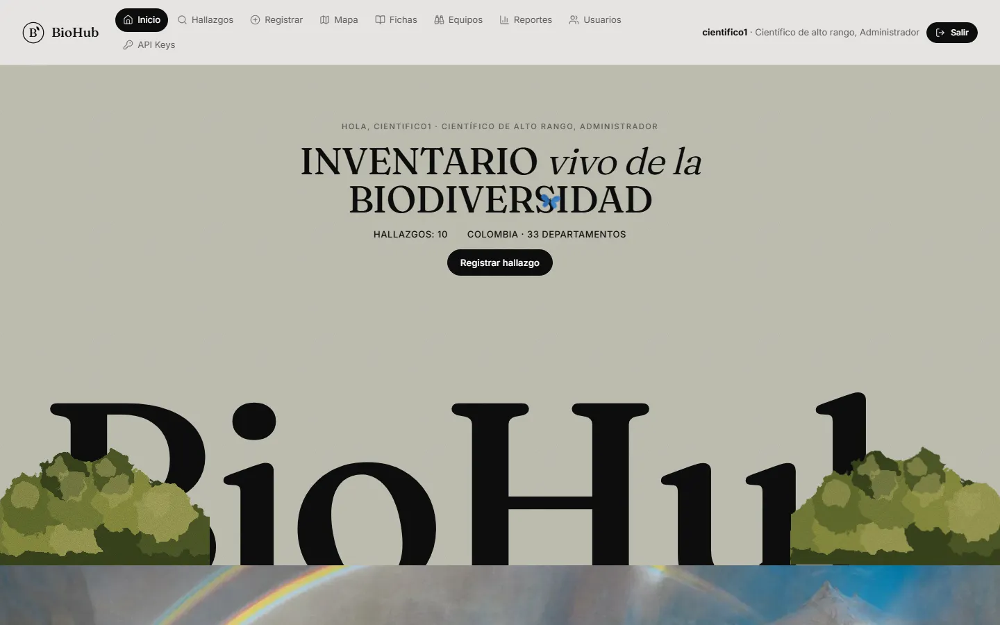<br><sub><b>Web interna · portada</b> · el menú muestra solo las salas del rol</sub></td>
    <td>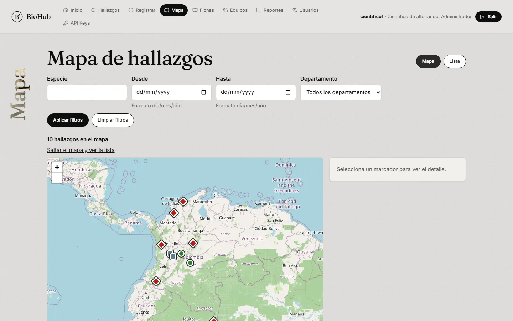<br><sub><b>Mapa de hallazgos</b> · coordenadas exactas solo para científico de alto rango; las teselas pasan por el gateway</sub></td>
  </tr>
  <tr>
    <td>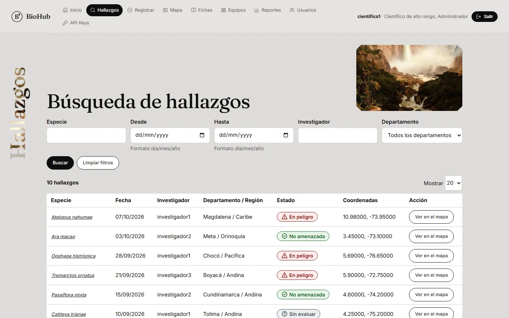<br><sub><b>Búsqueda interna</b> · filtros por especie, fechas y departamento</sub></td>
    <td>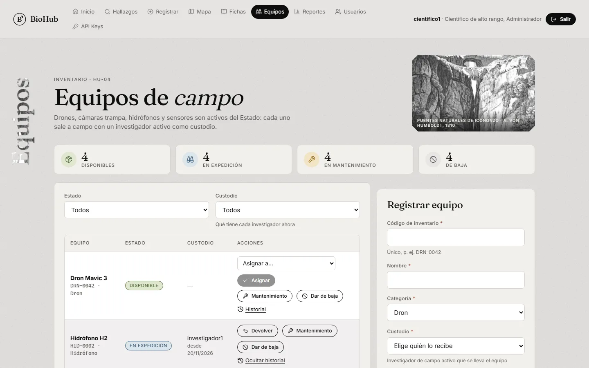<br><sub><b>Equipos de campo</b> · custodio obligatorio e historial de custodia</sub></td>
  </tr>
  <tr>
    <td>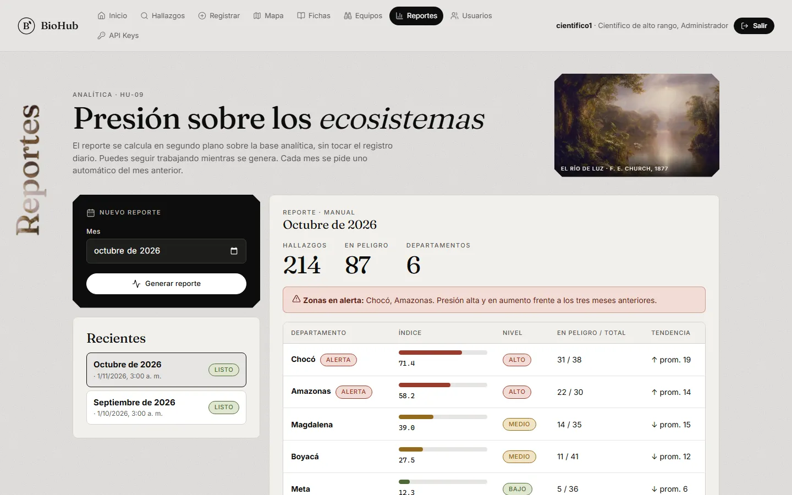<br><sub><b>Reportes</b> · índice de presión por departamento, con PDF y CSV</sub></td>
    <td>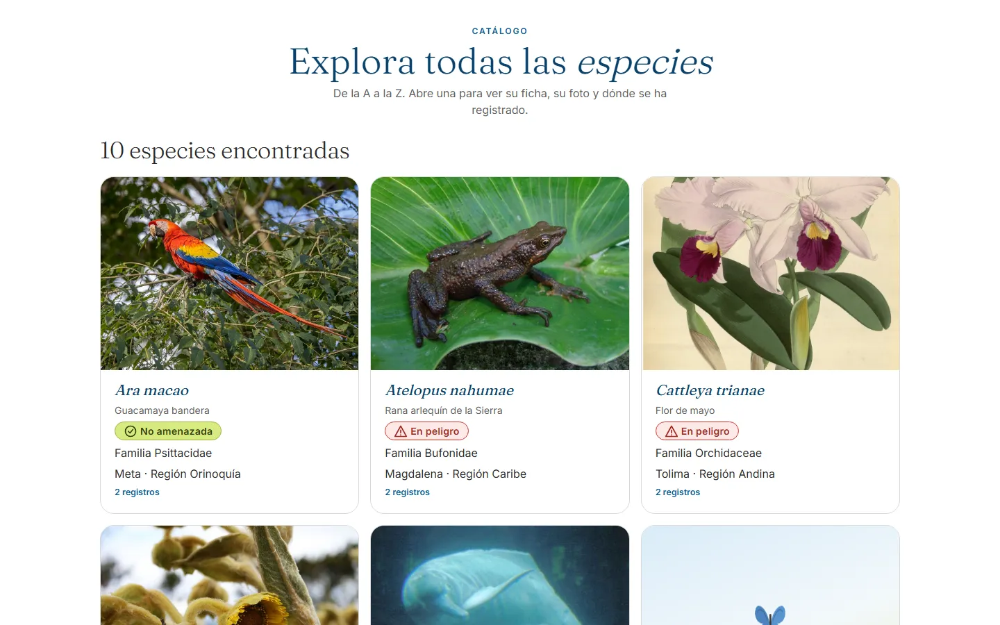<br><sub><b>Portal · catálogo</b> · una tarjeta por especie, con su foto pública</sub></td>
  </tr>
  <tr>
    <td>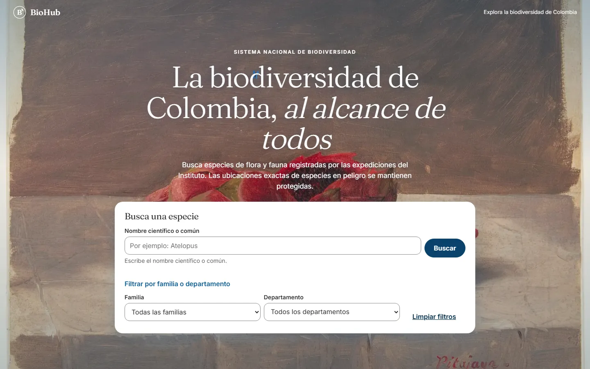<br><sub><b>Portal · inicio</b> · el buscador flota sobre una obra distinta en cada visita</sub></td>
    <td>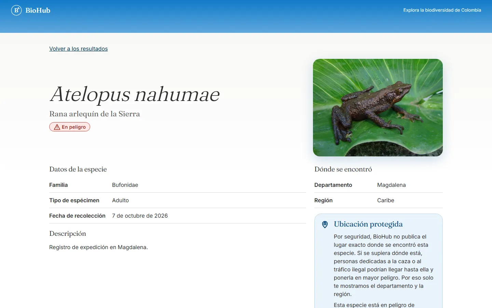<br><sub><b>Portal · ficha pública</b> · solo departamento y región: la ubicación exacta de una especie en peligro nunca sale del sistema</sub></td>
  </tr>
</table>

## 4. Arquitectura

**Estilo:** arquitectura basada en servicios + API Gateway propio + eventos asíncronos en topología *broker*. Cada servicio es dueño de su base de datos, y los datos que deben llegar a la lectura pública o a la analítica viajan por eventos.

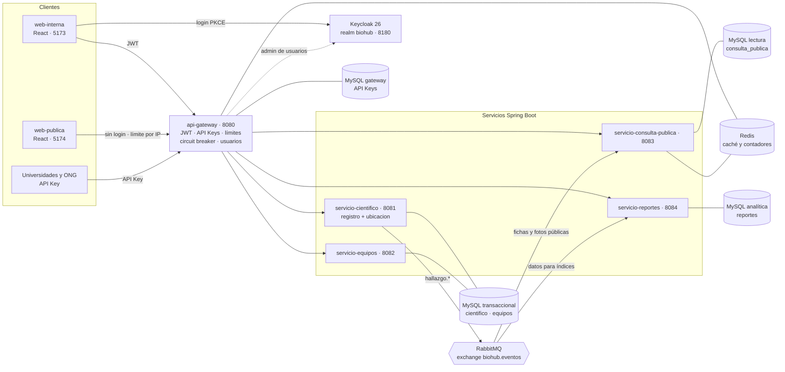

**Cómo viaja una petición:**

1. La web interna inicia sesión en Keycloak (Authorization Code + PKCE) y recibe un JWT de 5 minutos con `aud=biohub-api`.
2. Todo entra por el **gateway**: valida el JWT o la API Key, aplica el control grueso por rol y el límite de peticiones, y reenvía al servicio según el prefijo `/api/<prefijo>/**`.
3. **Cada servicio vuelve a validar el JWT** y decide con `@PreAuthorize` (defensa en profundidad). Los servicios escuchan solo en `127.0.0.1`: no se puede entrar sin pasar por el gateway.
4. Cuando cambia un hallazgo, `servicio-cientifico` publica un evento con la foto completa del hallazgo (sin coordenadas). Consulta pública y reportes lo aplican con "gana la versión mayor".

### Decisiones clave

Hay 66 decisiones registradas en [03-arquitectura.md](docs/equipo/03-arquitectura.md). Estas son las que más pesan:

| # | Decisión | Por qué |
|---|---|---|
| D1 | Gateway propio con Spring MVC + `RestClient` (sin Spring Cloud Gateway) | Requisito del curso y control explícito del reenvío |
| D14, D15 | Ningún dato público lleva coordenadas, y **todas** las coordenadas se cifran con AES-256-GCM | Si se filtran, los cazadores llegan a la especie: la falla segura es cifrar todo |
| D21, D44 | Un solo componente decide quién ve coordenadas, y ArchUnit impide saltárselo | "Infalible y centralizada", como pide el enunciado |
| D23, D24 | Eventos con la foto completa del hallazgo y su versión; el consumidor rechaza a la DLQ cualquier evento con coordenadas | Lecturas consistentes sin acoplar servicios, y una segunda barrera contra fugas |
| D25 | Caché pública en Redis (fichas 5 min, búsquedas 60 s), invalidada por evento | Resiste el pico ×60 sin tocar la base |
| D35, D39 | MySQL administrado en Aiven: dos servicios, una base y un usuario por servicio | Separa escritura de lectura y analítica |
| D46, D47 | Límite con ventana fija en Redis (scripts Lua) y API Keys guardadas como SHA-256 | Límite compartido entre instancias; una key filtrada de la base no sirve |
| D52 | Circuit breaker por servicio destino en el gateway | Un servicio caído no arrastra a los demás |
| D60 | Historial *append-only* también a nivel de permisos de MySQL | Ni siquiera un error de la aplicación puede reescribir la historia |
| D61 | Reportes asíncronos: la solicitud se guarda y se procesa en segundo plano | La analítica nunca frena el registro diario |
| D66 | Las fotos públicas viajan por evento a la base de lectura | El tráfico público ya no toca al servicio científico |

### Atributos de calidad (ASR)

| ASR | Exigencia | Cómo se verifica |
|---|---|---|
| ASR1 / RNF1 | Pico ×60 en la consulta pública: 95 % o más de respuestas sin 5xx | Pruebas de carga con k6 ([pruebas-carga/](pruebas-carga/README.md)) |
| ASR4 / RNF5 | Respuesta pública ≤ 2 s (p95), incluso con carga científica | k6 con carga mixta |
| ASR6 / RNF9 | 0 coordenadas en claro en BD, logs, eventos y caché | Pruebas QA que escanean las bases, los eventos y los logs |
| ASR7 / RNF10 | Historial inmutable y reconstruible | Pruebas de integración y permisos verificados en MySQL |
| ASR8, ASR9 | API Key obligatoria, 429 al pasar el límite, URLs estables | Pruebas del gateway y colección Bruno |
| HU-13 | Búsqueda interna < 3 s (p95) con 10.000 hallazgos | Medición documentada en [00-plan.md](docs/equipo/00-plan.md) (iteración 22) |

Los diagramas C4 (componentes y clases), de paquetes, de secuencia y la WBS están en [docs/Diagramas/](docs/Diagramas/). El SAD, el SRS, la presentación y el *project charter* originales están en [docs/docs originales/](docs/docs%20originales/).

## 5. Concepto artístico

BioHub se presenta como **una galería de museo**. La biodiversidad de Colombia ya fue pintada por los viajeros y las expediciones científicas del siglo XIX, y esas obras son de dominio público. Las usamos como paredes de la galería.

- **20 obras en tres lugares.** El carrusel del inicio interno, el cielo del portal y el fondo del inicio de sesión muestran las mismas 20 obras, en orden aleatorio en cada visita. Son de Frederic Edwin Church (sus bocetos de Colombia y Ecuador de 1853, *El corazón de los Andes*, *El Salto del Tequendama*, *El Río de Luz*), Martin Johnson Heade (colibríes y orquídeas), las acuarelas de la **Comisión Corográfica** (Carmelo Fernández, Henry Price), Edward Walhouse Mark y la lámina del cóndor de Humboldt y Bonpland. Las salas suman una lámina de la **Expedición Botánica** de Mutis y los puentes de Icononzo de Humboldt. Cada carpeta de imágenes tiene su `CREDITOS.md` con autor, museo, licencia y fuente.
- **El cóndor andino.** El ave del escudo de Colombia, que planea sobre la sabana de Bogotá y los páramos que la rodean, es el símbolo de la colección: su cabeza, grabada para el *Recueil d'observations de zoologie* de Humboldt y Bonpland (1811), es una de las 20 obras, y una silueta propia del cóndor, en la pose heráldica del ave del escudo de Bogotá, planea en círculos sobre el fondo del inicio de sesión y cruza la cabecera de este README.
- **La web interna es la galería.** Sigue [DESIGN.md](docs/diseño%20front/DESIGNS/WEB%20INTERNA/DESIGN.md): fondo color masilla, tinta negra y pinturas al óleo. Cada módulo es una **sala**: su nombre aparece en vertical en el margen y cada pintura lleva su **cartela**, como en un museo. Los mensajes del carrusel explican el sistema ("La ciencia se corrige, el historial se conserva").
- **El portal es el cielo abierto.** Más claro y azul, para cualquier visitante: el buscador flota sobre la pintura y el catálogo se recorre como una colección.
- **El inicio de sesión es la entrada.** Un tema propio de Keycloak (`infra/keycloak/themes/biohub`) con la tarjeta de la galería sobre una obra que cambia cada pocos segundos, y dos cóndores que giran en la térmica detrás de ella.
- **Tipografía:** *Fraunces* (serif de exhibición, para títulos y nombres científicos) e *Inter* (texto e interfaz). El monograma, el follaje, la mariposa morpho y el cóndor son SVG propios del proyecto.
- **Accesible y liviano.** Las obras se sirven en WebP en tres tamaños (800, 1600 y grande), solo se monta la pintura actual y sus vecinas, y se respeta `prefers-reduced-motion`.

## 6. Stack tecnológico


<details>
<summary><b>El detalle por capa</b></summary>

| Capa | Tecnologías |
|---|---|
| **Backend** | Java 21, Spring Boot 3.5.16 (Web MVC, Security con OAuth2 Resource Server, Data JPA, AMQP, Data Redis, Cache), Flyway, Hibernate (`ddl-auto: validate`), Caffeine |
| **Frontend** | React 19, Vite 8, React Router 8, keycloak-js 26, Leaflet + React Leaflet, Lucide, Fraunces e Inter (Fontsource) |
| **Identidad** | Keycloak 26 (realm `biohub`, 5 roles, tema de inicio de sesión propio) |
| **Datos** | MySQL 8.4 (4 bases, una por contexto), Redis 7.4 (caché y contadores) |
| **Mensajería** | RabbitMQ 4.1, exchange *topic* `biohub.eventos`, colas con DLQ y un usuario AMQP por servicio |
| **Pruebas** | JUnit 5, Testcontainers (MySQL, RabbitMQ y Redis reales), ArchUnit, Vitest + Testing Library, Playwright (Chromium, Firefox y WebKit), k6, Bruno |
| **Infraestructura** | Docker Compose para la infraestructura local, Aiven (MySQL administrado con SSL), GitHub Actions |

</details>

## 7. Estructura del repositorio

```
BioHub/
├── api-gateway/                # Enrutamiento, JWT, API Keys, límites, circuit breaker, usuarios, teselas del mapa
├── servicio-cientifico/        # Módulos registro (hallazgos, fichas, evidencias, historial) y ubicacion (cifrado, mapa, búsqueda)
├── servicio-equipos/           # Equipos de campo y su historial de custodia
├── servicio-consulta-publica/  # Modelo de lectura alimentado por eventos + caché Redis
├── servicio-reportes/          # Índices de presión mensuales, PDF y CSV
├── web-interna/                # React: la galería del Instituto (login con Keycloak)
├── web-publica/                # React: el portal público
├── infra/
│   ├── keycloak/               # realm-biohub.json y el tema de inicio de sesión "biohub"
│   ├── mysql/initdb/           # usuarios *_app y *_migr de las 4 bases (mismos permisos que en Aiven)
│   └── rabbitmq/               # usuarios AMQP por servicio
├── deploy/aiven/               # SQL de usuarios y del historial append-only para Aiven
├── pruebas-carga/              # k6 para los ASR de rendimiento
├── bruno/                      # colección de peticiones para probar la API a mano
├── scripts/                    # sembrar-demo.mjs: datos de ejemplo
├── docs/                       # equipo/ (plan, arquitectura, contrato, ADR, QA), diagramas, documentos originales y capturas
├── docker-compose.yml          # infraestructura local (MySQL ×4, Redis, RabbitMQ, Keycloak)
├── levantar.ps1 / .cmd / .sh   # levanta todo con un comando
├── .env.example                # plantilla de variables (el .env real nunca se sube)
└── pom.xml                     # Maven agregador
```

Los paquetes siguen `co.edu.unbosque.biohub.<servicio>.{controller, service, domain, infrastructure, config}`. En `servicio-cientifico`, los módulos `registro` y `ubicacion` **no importan clases internas del otro**: se comunican por una clase pública de `service` o por eventos, y ArchUnit lo comprueba.

## 8. Cómo levantarlo

### Requisitos

| Herramienta | Versión |
|---|---|
| Git | cualquiera reciente |
| Java (JDK) | 21 |
| Maven | 3.9 o superior |
| Node.js | 22 |
| Docker + Docker Compose | Compose v2 (`docker compose`, con espacio) |

Verifica con `git --version`, `java -version`, `mvn -version`, `node -v` y `docker compose version`. En Ubuntu, para usar Docker sin `sudo`: `sudo usermod -aG docker $USER` y vuelve a iniciar sesión.

### Inicio rápido

**1. Crea el `.env`** desde la plantilla y cambia todas las contraseñas (`cambiar_...`). La de `KEYCLOAK_TEST_USERS_PASSWORD` debe tener 12 caracteres o más. No escribas `${...}` dentro del `.env` y nunca lo subas.

```powershell
Copy-Item .env.example .env
```

**2. Levanta todo.** En Windows, desde la raíz del repo:

```powershell
.\levantar.ps1 -Sembrar
```

Si PowerShell no deja correr scripts, usa `levantar.cmd` desde CMD con los mismos parámetros. En Linux o macOS (bash 4 o superior, con `curl`):

```bash
./levantar.sh --sembrar
```

**3. Abre las webs:** http://localhost:5173 (interna) y http://localhost:5174 (portal). Al final, `levantar` muestra la tabla de puertos y los usuarios de prueba.

### Qué hace `levantar`

1. Revisa Java 21, Maven, Node y Docker. Si Docker Desktop está apagado, lo prende.
2. Revisa que el `.env` tenga las variables obligatorias, sin mostrar sus valores. En local genera las que faltan (llaves de cifrado, contraseñas de migración y el secreto del cliente del gateway).
3. Revisa que los puertos estén libres.
4. Sube los contenedores, espera a que estén sanos y ajusta los usuarios de las 4 bases (`*_app` sin permisos sobre el esquema, `*_migr` solo para Flyway), sin borrar datos.
5. Compila los servicios si algo cambió.
6. Arranca los 5 servicios en segundo plano. Cuando Flyway ya creó las tablas, bloquea el historial (D60) y lo comprueba.
7. Arranca las dos webs (corre `npm ci` si faltan dependencias).

| Parámetro (Windows / Linux) | Para qué |
|---|---|
| `-Sembrar` / `--sembrar` | Crea datos de ejemplo: hallazgos, equipos y un reporte |
| `-Estado` / `--estado` | Muestra qué está arriba, sin arrancar nada |
| `-Detener` / `--detener` | Apaga servicios y webs y detiene los contenedores (los datos se conservan) |
| `-Compilar` / `--compilar` | Compila aunque no haya cambios |
| `-ReimportarRealm` / `--reimportar-realm` | Vuelve a importar el realm. Úsalo si los usuarios de prueba no entran o si la sala Usuarios dice que no está disponible |
| `-Perfil aiven` / `--perfil aiven` | Bases en Aiven en vez de Docker ([09-despliegue.md](docs/equipo/09-despliegue.md) §4) |
| `-ArchivoEnv <ruta>` / `--env <ruta>` | Usa otro archivo de variables (por ejemplo, un segundo entorno con otros puertos) |

Los logs quedan en `.biohub-local/logs/` (no se suben).

<details>
<summary><b>Levantarlo a mano, paso a paso</b></summary>

Todos los comandos se ejecutan desde la raíz del repo, salvo que se indique otra carpeta.

**Infraestructura:**

```bash
docker compose up -d
docker compose ps        # repite hasta que los 7 contenedores estén "healthy" (Keycloak tarda 30-60 s)
```

Cada base se crea con dos usuarios, como en Aiven: `MYSQL_<X>_USER` (el `*_app`, solo lee y escribe datos) y `<P>_MIGR_USER` (el `*_migr`, el único que crea o cambia tablas; lo usa Flyway). Después del primer arranque de `servicio-cientifico`, bloquea el historial (`levantar` lo hace solo):

```bash
docker exec biohub-mysql-transaccional bash /docker-entrypoint-initdb.d/01-usuarios.sh   # debe decir "historial protegido"
```

**Servicios** (uno por terminal, **desde la carpeta del servicio**, porque leen `../.env`):

```bash
mvn -DskipTests package
cd servicio-cientifico
SPRING_PROFILES_ACTIVE=local mvn spring-boot:run    # MySQL del docker-compose
SPRING_PROFILES_ACTIVE=aiven mvn spring-boot:run    # MySQL en Aiven con SSL
```

Repite con `api-gateway`, `servicio-equipos`, `servicio-consulta-publica` y `servicio-reportes`. Sin perfil no arrancan: no hay URL ni credenciales por defecto. Si arrancas desde otra carpeta, no encuentran el `.env` (el import es `optional`, así que no avisan) y fallan al conectarse a la base.

**Webs** (los puertos son fijos: si están ocupados, Vite falla en vez de cambiar de puerto):

```bash
cd web-interna && npm install && npm run dev     # http://localhost:5173
cd web-publica && npm install && npm run dev     # http://localhost:5174
```

**Probar la API por consola:**

```bash
set -a; . ./.env; set +a
TOKEN=$(curl -s -X POST "http://localhost:${KEYCLOAK_PORT}/realms/biohub/protocol/openid-connect/token" \
  -d grant_type=password -d client_id=biohub-pruebas \
  -d username=investigador1 --data-urlencode "password=${KEYCLOAK_TEST_USERS_PASSWORD}" | jq -r .access_token)
curl -s -H "Authorization: Bearer $TOKEN" http://localhost:8080/api/cientifico/ping
```

Sin token la respuesta es `401`. Otros pings: `/api/gateway/ping`, `/api/equipos/ping`, `/api/publica/ping` (sin token) y `/api/reportes/ping`. El contrato completo está en [04-contrato-api.md](docs/equipo/04-contrato-api.md).

</details>

### Puertos

Todo se publica **solo en 127.0.0.1**: no es accesible desde otras máquinas de la red.

| Componente | Puerto | | Componente | Puerto |
|---|---|---|---|---|
| web-interna | 5173 | | keycloak | 8180 ([consola](http://localhost:8180/admin)) |
| web-publica | 5174 | | mysql-transaccional | 3307 |
| api-gateway | 8080 | | mysql-lectura | 3308 |
| servicio-cientifico | 8081 | | mysql-analitica | 3309 |
| servicio-equipos | 8082 | | mysql-gateway | 3310 |
| servicio-consulta-publica | 8083 | | redis | 6379 |
| servicio-reportes | 8084 | | rabbitmq | 5672 ([panel](http://localhost:15672)) |

### Usuarios de prueba (realm `biohub`)

| Usuario | Rol |
|---|---|
| `investigador1` | investigador_campo |
| `auditor1` | auditor_cientifico |
| `cientifico1` | cientifico_alto_rango |
| `analista1` | analista_ambiental |
| `admin1` | administrador |
| `sinrol1` | ninguno: sirve para comprobar que un usuario sin rol no entra |

La contraseña de todos es el valor de `KEYCLOAK_TEST_USERS_PASSWORD` **de tu propio `.env`**. Para crear más usuarios, entra como `admin1` a la sala Usuarios. El cliente `biohub-pruebas` (password grant) es **solo para desarrollo**; la web usa `web-interna` con Authorization Code + PKCE.

## 9. Pruebas y CI

```bash
mvn test                       # desde la raíz: los 5 servicios (Testcontainers necesita Docker encendido)
cd web-interna && npm test     # Vitest
cd web-publica && npm test
npx playwright test            # E2E, dentro de cada web
```

| Tipo | Qué cubre |
|---|---|
| **Unitarias e integración** | Dominio, servicios y controladores de los 5 servicios, contra MySQL, RabbitMQ y Redis reales con Testcontainers |
| **Arquitectura** | ArchUnit: los módulos no se importan entre sí y nadie se salta el control de coordenadas |
| **Seguridad y QA** | Endpoints sin token o con el rol equivocado, ninguna coordenada en claro en bases, eventos, caché ni logs, historial inmutable |
| **Webs** | Vitest + Testing Library en las salas internas y el portal; Playwright en Chromium, Firefox y WebKit (RNF13) |
| **Carga** | k6 para el pico ×60 y la respuesta pública ([pruebas-carga/](pruebas-carga/README.md)) |
| **Manual** | Colección [Bruno](bruno/) con las peticiones de cada servicio |

**GitHub Actions** ([ci.yml](.github/workflows/ci.yml)) corre en cada push y pull request: build y pruebas de las dos webs con E2E, `mvn verify` de cada servicio en una matriz (algunos también con `TZ=America/Bogota`) y la colección Bruno.

## 10. Despliegue

- **MySQL** administrado en **Aiven**: dos servicios (escritura: `cientifico` y `equipos`; lectura: `consulta_publica`, `reportes` y `gateway`), SSL con verificación del CA y un usuario `*_app` y otro `*_migr` por base. Perfil Spring `aiven`.
- **RabbitMQ, Redis y Keycloak** en Docker (`docker-compose.yml`). El compose también trae los MySQL locales para el perfil `local`.
- **Sin internet:** perfil `local` contra los MySQL del compose.

Guía completa (Aiven, CA, variables, vuelta atrás): [09-despliegue.md](docs/equipo/09-despliegue.md). Plan de la Entrega 3: [12-plan-despliegue-entrega-3.md](docs/equipo/12-plan-despliegue-entrega-3.md). Las credenciales (`.env`, `ca.pem`) no están en el repo: se piden por un canal privado.

## 11. Ramas y flujo de trabajo

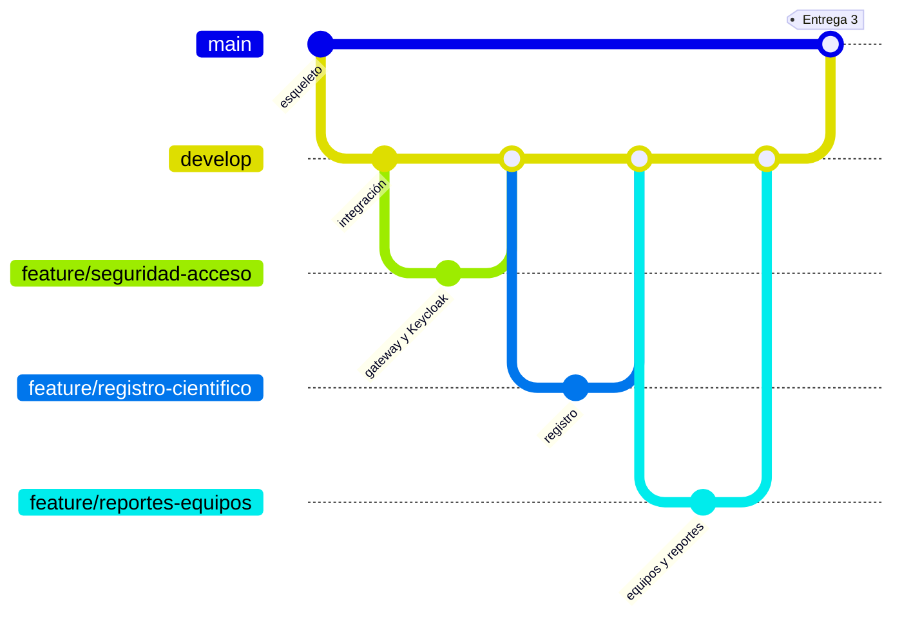

| Rama | Para qué | Responsable |
|---|---|---|
| `main` | Solo entregas. Recibe `develop` por pull request en cada entrega | Todo el equipo |
| `develop` | Integración: todo entra por pull request con la CI en verde | Todo el equipo |
| `feature/ubicacion-consulta-publica` | Ubicación cifrada, mapa, búsqueda, consulta pública y portal | Juanita |
| `feature/seguridad-acceso` | Gateway, Keycloak, roles, web interna e infraestructura compartida | Santiago |
| `feature/registro-cientifico` | Registro de hallazgos, fichas, evidencias e historial | Hernando |
| `feature/reportes-equipos` | Equipos de campo y reportes analíticos | Nicolás |
| `feature/revision-*`, `feature/correcciones-revision`, `fix/*` | Revisiones generales, correcciones e integración entre ramas | Quien abrió la revisión |

`main` y `develop` están **protegidas**: nada de push directo ni *force push*, todo entra por pull request y cada quien puede fusionar el suyo. Antes de abrir el PR, actualiza tu rama con `develop` y comprueba que `mvn test` (y `npm test` si tocaste una web) pasen.

- **Commits:** Conventional Commits en español (`feat:`, `fix:`, `docs:`, `test:`, `refactor:`, `chore:`).
- **Migraciones Flyway:** `V<AAAAMMDD_HHMM>__descripcion.sql`, para que dos personas en el mismo esquema nunca choquen. Nunca se edita una migración aplicada: se crea otra.
- **Zonas compartidas** (las coordina Santiago y se avisa antes de tocarlas): `pom.xml` raíz, `docker-compose.yml`, `infra/`, el realm de Keycloak y `config/` de `servicio-cientifico`.

## 12. Equipo: quién hizo qué

<table>
  <tr>
    <td valign="top" width="50%">
      <h3>Juanita Mejía Pineda</h3>
      <a href="https://github.com/JuaniMP">@JuaniMP</a> · Ubicación y consulta pública<br><br>
      <b>Ubicación, consulta pública y portal</b>
      <ul>
        <li>Cifrado AES-256-GCM de coordenadas, llaves versionadas y re-cifrado</li>
        <li>Control centralizado de quién ve coordenadas (Strategy + Decorator + ArchUnit)</li>
        <li>Mapa y búsqueda interna, con auditoría de accesos</li>
        <li><code>servicio-consulta-publica</code>: modelo de lectura por eventos, caché Redis y DLQ</li>
        <li>CI en GitHub Actions, MySQL en Aiven y pruebas de carga con k6</li>
        <li>Plan de trabajo, revisiones de QA y seguridad e integración de los PR en develop</li>
      </ul>
    </td>
    <td valign="top" width="50%">
      <h3>Santiago Pinzón Vásquez</h3>
      <a href="https://github.com/Chocax">@Chocax</a> · Frontend developer · seguridad e infraestructura<br><br>
      <b>Las dos webs, el gateway, Keycloak e infraestructura</b>
      <ul>
        <li><b>Frontend:</b> diseño y construcción de <code>web-interna</code> y <code>web-publica</code>: el concepto de galería, las salas, el carrusel de las 20 obras, el cóndor, el catálogo por especie, la CSP y las pruebas de las salas</li>
        <li>Tema de inicio de sesión de Keycloak con el estilo de la galería</li>
        <li><code>api-gateway</code>: API Keys, límites en Redis, circuit breaker, teselas del mapa y administración de usuarios</li>
        <li>Keycloak: realm y roles</li>
        <li>Historial append-only en MySQL, usuarios <code>*_app</code>/<code>*_migr</code> y limpieza de GPS en evidencias</li>
        <li>Reportes en PDF y CSV con el diseño de BioHub</li>
        <li><code>levantar.ps1</code> y <code>levantar.sh</code>, y la infraestructura compartida</li>
      </ul>
    </td>
  </tr>
  <tr>
    <td valign="top">
      <h3>Hernando Javier García Mogollón</h3>
      <a href="https://github.com/Nandoski666">@Nandoski666</a> · Registro científico<br><br>
      <b>Módulo <code>registro</code> de <code>servicio-cientifico</code></b>
      <ul>
        <li>Registro y reclasificación de hallazgos con versiones</li>
        <li>Fichas flexibles con plantillas por especie</li>
        <li>Publicación de los eventos <code>hallazgo.*</code></li>
        <li>Idempotencia del registro y correcciones de la revisión final</li>
      </ul>
    </td>
    <td valign="top">
      <h3>Nicolás Espinosa Estrada</h3>
      <a href="https://github.com/Gattocho888">@Gattocho888</a> · Equipos y reportes<br><br>
      <b><code>servicio-equipos</code> y <code>servicio-reportes</code></b>
      <ul>
        <li>Inventario de equipos de campo, custodia e historial</li>
        <li>Reportes analíticos alimentados por eventos</li>
        <li>Normalización de departamentos y protección contra inyección en CSV</li>
        <li>Script de verificación de RNF3</li>
      </ul>
    </td>
  </tr>
</table>

**Dependencias entre personas:** el evento `hallazgo.*` lo publica registro (Hernando) y lo consumen consulta pública (Juanita) y reportes (Nicolás); su formato está en [04-contrato-api.md](docs/equipo/04-contrato-api.md). El esquema `cientifico` lo comparten registro y ubicación. Los roles y permisos los define seguridad (Santiago) y cada servicio protege sus endpoints con ellos. El detalle por iteración está en [00-plan.md](docs/equipo/00-plan.md).

## 13. Solución de problemas

<details>
<summary><b>Ver problemas frecuentes</b></summary>

| Problema | Solución |
|---|---|
| Puerto ocupado | Busca el proceso (`netstat -ano \| findstr :8081` en Windows, `ss -ltnp \| grep :8081` en Linux), ciérralo o cambia el puerto en `.env` |
| Los usuarios de prueba no entran | `levantar -ReimportarRealm`: el realm se importa solo la primera vez |
| La sala Usuarios dice que la administración no está disponible | Tu Keycloak no tiene el cliente `biohub-gateway`: `levantar -ReimportarRealm` |
| Keycloak no responde al iniciar | Tarda 30-60 s. Revisa `docker compose ps` y `docker compose logs keycloak` |
| `401` con un token que antes servía | El token dura 5 minutos: pide otro |
| El servicio no encuentra el `.env` o no conecta a la BD | Ejecútalo desde la carpeta del servicio (lee `../.env`) |
| `docker compose up` dice "Falta en .env" | Compara tu `.env` con `.env.example` |
| Flyway falla con `CREATE command denied` | Faltan `<P>_MIGR_USER/PASSWORD` en el `.env` |
| Cambié contraseñas de MySQL y ya no conecta | Con `levantar` no pasa. A mano: `docker exec biohub-mysql-<base> bash /docker-entrypoint-initdb.d/01-usuarios.sh` (no borra datos) |
| MySQL init falla con "caracteres no permitidos" | Las contraseñas solo admiten letras, números y `_.@#%+=-` |
| No puedo llamar a un servicio (8081-8084) desde otra máquina | A propósito: escuchan solo en `127.0.0.1` para obligar a pasar por el gateway |
| `levantar.ps1` no corre por la política de ejecución | Usa `levantar.cmd` desde CMD |
| Un `.sh` falla con `bad interpreter` o `$'\r'` | Quedó con fin de línea de Windows: `sed -i 's/\r$//' archivo.sh` |
| Las pruebas Maven fallan con errores de Testcontainers | Docker Desktop está apagado: enciéndelo y repite |

</details>

## 14. Documentación

| Documento | Contenido |
|---|---|
| [00-plan.md](docs/equipo/00-plan.md) | Plan, iteraciones y resultados de verificación |
| [01-requisitos.md](docs/equipo/01-requisitos.md) | Historias refinadas, criterios de aceptación y RNF medibles |
| [02-diseno-ux.md](docs/equipo/02-diseno-ux.md) | Diseño de las pantallas |
| [03-arquitectura.md](docs/equipo/03-arquitectura.md) | Arquitectura y las 66 decisiones; los ADR largos en [adr/](docs/equipo/adr/) |
| [04-contrato-api.md](docs/equipo/04-contrato-api.md) | Contrato de API y de eventos |
| [05-modelo-datos.md](docs/equipo/05-modelo-datos.md) | Modelo de datos |
| [06-plan-pruebas.md](docs/equipo/06-plan-pruebas.md) y [07-reporte-qa.md](docs/equipo/07-reporte-qa.md) | Plan de pruebas y resultados |
| [08-reporte-seguridad.md](docs/equipo/08-reporte-seguridad.md) | Auditoría de seguridad |
| [09-despliegue.md](docs/equipo/09-despliegue.md) y [12-plan-despliegue-entrega-3.md](docs/equipo/12-plan-despliegue-entrega-3.md) | Despliegue en Aiven y plan de la Entrega 3 |
| [10-verificacion-sad.md](docs/equipo/10-verificacion-sad.md) | Verificación del código contra el SAD |
| [11-seguridad-y-acceso.md](docs/equipo/11-seguridad-y-acceso.md) | Cómo entra cada petición y la matriz de roles |
| [trazabilidad.md](docs/equipo/trazabilidad.md) | Trazabilidad de requisitos a código y pruebas |
| [CHANGELOG.md](CHANGELOG.md) | Cambios por versión |

## 15. Créditos y licencia

- **Autores:** Juanita Mejía Pineda, Santiago Pinzón Vásquez, Hernando Javier García Mogollón y Nicolás Espinosa Estrada. Ingeniería de Software 2, Universidad El Bosque.
- **Obras:** todas de dominio público o CC0 (Wikimedia Commons, Smithsonian Cooper Hewitt, Biblioteca Nacional de Colombia y la biblioteca de libros raros de McGill en Internet Archive). El crédito completo de cada una está en `web-interna/public/pinturas/CREDITOS.md`, `web-publica/public/pinturas/CREDITOS.md` y `infra/keycloak/themes/biohub/login/resources/img/CREDITOS.md`.
- **Mapa:** © colaboradores de OpenStreetMap.
- **Licencia del código:** [MIT](LICENSE). Las obras y fotografías conservan su propia licencia (dominio público, CC0 o la que indique cada `CREDITOS.md`).
